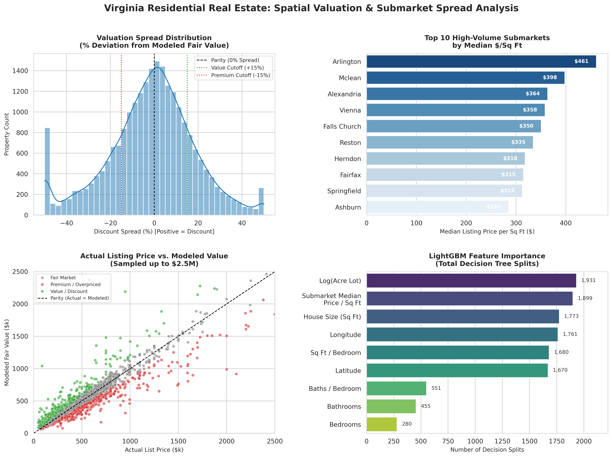

# Virginia Residential Real Estate: Spatial Valuation & Deal Sourcing Engine

An end-to-end automated valuation and spatial analytics pipeline analyzing 23,435 geocoded residential properties across Virginia. This project leverages gradient-boosted decision trees (LightGBM) to evaluate intrinsic property value, quantify submarket premiums, and isolate mispriced assets for acquisition analysis.



---

## 1. Executive Summary & Business Problem

Automated Valuation Models (AVMs) often treat geography as flat categorical labels (such as city or county names), missing spatial autocorrelation, micro-neighborhood price gradients, and parcel utility. Consequently, real estate investors and acquisition teams spend hundreds of manual underwriting hours screening listings to identify truly discounted assets.

This project addresses two core business objectives:
1. **Explainable Spatial Valuation:** Train a predictive engine incorporating continuous physical coordinates alongside submarket baselines to estimate fair property value without geographic distortion.
2. **Automated Deal Sourcing:** Calculate the valuation residual spread to programmatically flag properties trading at significant discounts ($\ge 25\%$) relative to their local micro-market.

---

## 2. Dataset & Methodology

* **Source Data:** Filtered and deduplicated slice of Realtor.com residential sales across the Commonwealth of Virginia (23,435 valid single-family listings).
* **Data Cleaning & Scoping:**
  * Deduplicated multi-scrape listings on physical address, lot size, and price.
  * Screened outlier anomalies (restricted to single-family homes: 1–10 beds, 1–10 baths, 400–15,000 sq ft, \$50k–\$5M list price).
  * Imputed missing parcel acreage using localized zip-code median lot sizes.
* **Spatial Feature Engineering:**
  * Batch-geocoded 5-digit postal codes to geographic centroids (`latitude`, `longitude`).
  * Engineered submarket benchmarks: computed hierarchical median price-per-square-foot metrics at the zip-code level, regressing to city baselines for low-sample postal codes.
  * Derived layout allocation features: `sqft_per_bed`, `bath_per_bed`, and `log_acre_lot`.

---

## 3. Model Architecture & Performance

A **LightGBM Regressor** was trained on an 80/20 train/test split, predicting log-transformed listing price ($\ln(1 + \text{Price})$) to stabilize variance and mitigate high-end skew.

* **Variance Explained ($R^2$):** `0.8502` (explaining 85.0% of test set price variance).
* **Mean Absolute Percentage Error (MAPE):** `19.48%` (within acceptable limits for unrenovated asking prices).
* **Dollar Root Mean Squared Error (RMSE):** `$198,736.96` (reflecting skew from multi-million-dollar luxury properties in Northern Virginia and Charlottesville).

### Key Feature Drivers (Decision Splits)
1. **Parcel Size (`log_acre_lot` - 1,931 splits):** Land utility and acreage represent the primary pricing differentiator across Virginia's rural-to-urban gradient.
2. **Submarket Baseline (`submarket_median_price_sqft` - 1,899 splits):** Local market tiering anchors property expectations.
3. **Physical Mass (`house_size` - 1,773 splits):** Gross living area square footage.
4. **Spatial Coordinates (`longitude`: 1,761 / `latitude`: 1,670 splits):** Combined 3,400+ splits allow non-linear spatial boundaries to capture micro-neighborhood premiums.

---

## 4. Investment Deliverable: The Interactive Deal Map

Properties are classified into three investment categories based on the **Valuation Spread**:
$$\text{Discount Spread (\%)} = \frac{\text{Modeled Fair Value} - \text{Listing Price}}{\text{Modeled Fair Value}} \times 100$$

* **Fair Market (60.4%):** Priced within $\pm 15\%$ of model expectations.
* **Premium / Overpriced (21.6%):** Priced $>15\%$ above modeled fair value.
* **Value / Discount (18.0%):** Priced $>15\%$ below modeled fair value.

An interactive spatial map (`virginia_real_estate_valuation_map.html`) was constructed using Folium and Esri's Gray Canvas tiles, featuring:
* Density clustering for the statewide sample (23k properties).
* A filtered layer highlighting the top 500 value-add opportunities ($\ge 25\%$ discount) with hover metadata (beds, baths, list price, modeled value, and spread).

---

## 5. Repository Structure

```text
├── data/
│   └── cleaned_va_real_estate.csv       # Preprocessed and geocoded dataset
├── notebooks/
│   └── va_real_estate_pipeline.ipynb    # Kaggle notebook containing full workflow
├── visuals/
│   ├── virginia_real_estate_insights.png# 4-panel executive summary dashboard
│   └── virginia_real_estate_valuation_map.html # Interactive Folium map
├── README.md
└── requirements.txt
